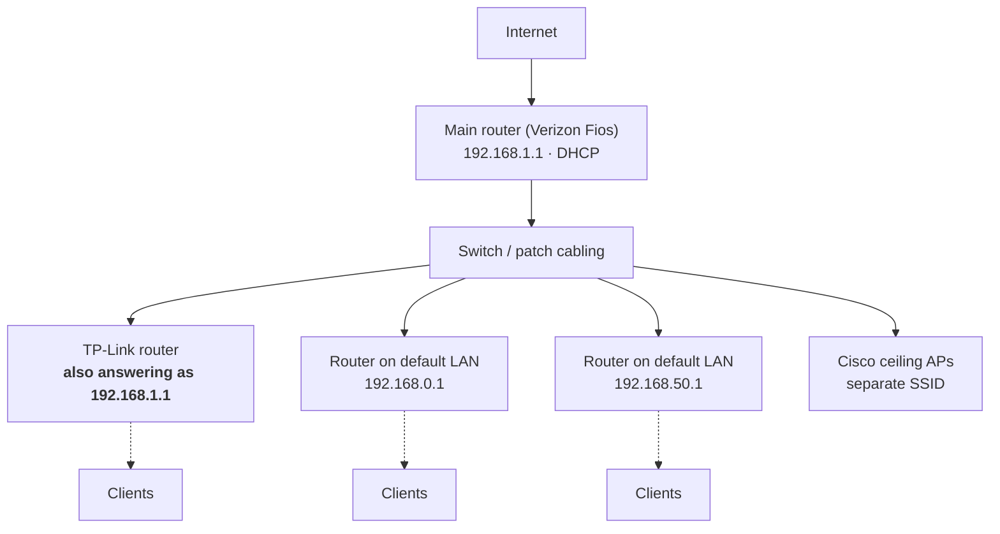
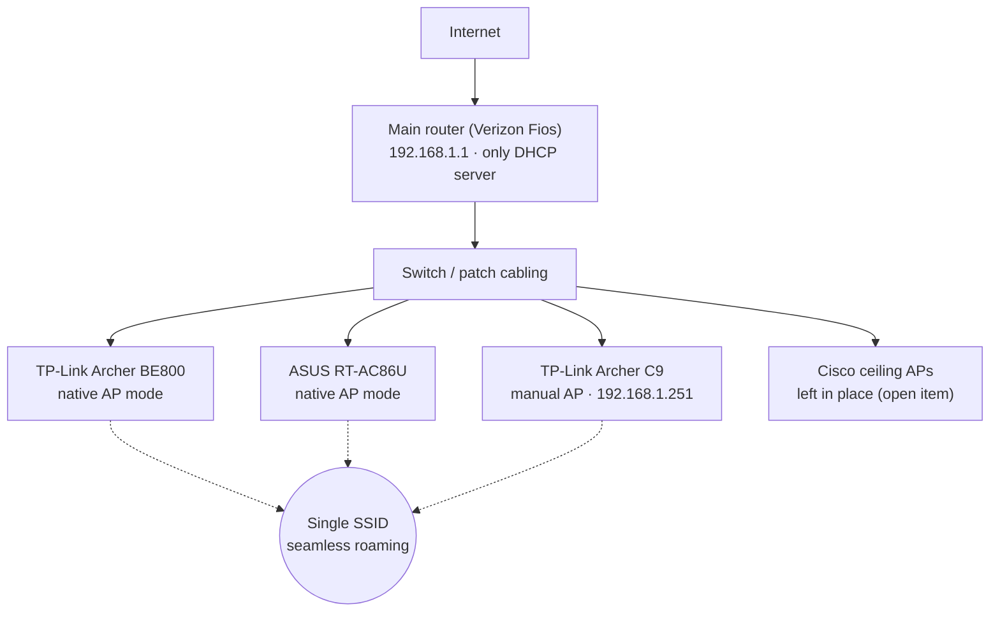

# Church Network Troubleshooting & Consolidation

Diagnosing and fixing an unstable multi-router network at a church, using packet analysis to find the root cause and a follow-up capture to verify the fix.

> **Role:** IT Volunteer, The New Church of NY (2025)
> **Scope:** Main floor network (one main router, three secondary routers, existing ceiling APs)
> **Tools:** Wireshark, `ping`, `ipconfig`, router admin consoles, MAC OUI lookup

---

## TL;DR

| | |
|---|---|
| **Problem** | Internet dropped in and out; speeds swung between fast and unusable. Clients sometimes received `Destination net unreachable` from the gateway. |
| **Root cause** | A secondary TP-Link router was still answering as **192.168.1.1**, the same address as the main gateway. Wireshark flagged `duplicate use of 192.168.1.1 detected!` in ARP traffic. Other secondary routers were still running their own default subnets (192.168.0.x, 192.168.50.x) on the same LAN. |
| **Fix** | Made the main router the only gateway and DHCP server. Converted every secondary router to an access point: native AP mode where supported, and manual configuration (DHCP off, static IP outside the conflict) on a model without AP mode. Unified the SSID for roaming. Resolved a separate link failure caused by a port negotiation issue on the main router. |
| **Result** | A follow-up capture showed **no duplicate-IP warnings**. The device that had been broadcasting from 192.168.1.1 now broadcast from its new address, 192.168.1.251, confirming the conflict was gone. |

---

## Network at a Glance

**Before**

**After**

---

## Contents

| # | Section | What it covers |
|---|---|---|
| 1 | [Initial assessment](docs/01-initial-assessment.md) | Symptoms, existing equipment, mixed subnets |
| 2 | [Wireshark analysis](docs/02-wireshark-analysis.md) | Finding the duplicate gateway IP and identifying the device |
| 3 | [Reconfiguration](docs/03-reconfiguration.md) | Converting each router to an AP; native vs. manual AP setup; roaming |
| 4 | [Physical-layer troubleshooting](docs/04-physical-layer.md) | Narrowing a link failure with `ping` / `ipconfig`; port negotiation fix |
| 5 | [Verification](docs/05-verification.md) | Follow-up capture confirming the fix |
| 6 | [Open items & recommendations](docs/06-open-items.md) | Legacy Cisco APs, WPA2-only mode, subnet sizing, multicast cleanup |

---

## Key Takeaways

- **Packet captures beat guesswork.** Intermittent drops have many possible causes (cabling, DHCP, ISP); the ARP duplicate-IP warning pointed directly at the real one.
- **"AP mode" is not the same on every device.** Two routers had a native AP mode that disabled DHCP automatically. The older model had none, so it had to be turned into an AP by hand: DHCP off, static IP inside the main subnet, uplink on a LAN port.
- **Verify, don't assume.** A second capture after the change is what proves the problem is gone.
- **Record what is left.** The legacy Cisco APs still broadcast a separate SSID; they are documented as an open item rather than ignored.

---

## Privacy & Scope

- Work was performed on the church's own network as a volunteer, at the church's request.
- Wi-Fi credentials, account details, real MAC addresses, and public IP addresses have been removed or masked. Private RFC 1918 addresses (192.168.x.x) are shown because they reveal nothing outside the local network.
